<div align="center">


# Plataforma Integral de Gobernanza de Datos, Inteligencia Artificial Hospitalaria (RAG) y Operaciones Clínicas
### **Sanatorio Argentino S.A. / S.R.L.** · *Área de Innovación y Transformación Digital × Grow Labs*

[](https://react.dev/)
[](./sync-server/index.js)
[](https://supabase.com/)
[](./src/components/BetoWidget.jsx)
[](#)

*Ecosistema hospitalario Data-Driven que unifica el HIS transaccional **SALUS SQL Server** con una arquitectura moderna de **Gobernanza de Datos**, **Auditoría Clínica Automatizada**, **Tableros Ejecutivos en Tiempo Real** y **Asistentes Virtuales Multi-Sectoriales con RAG y Voz Neuronal**.*

</div>

---

## 📋 Índice General

1. [Visión General y Problema que Resuelve](#-1-visión-general-y-problema-que-resuelve)
2. [Arquitectura Técnica y Cómo Funciona (Under the Hood)](#-2-arquitectura-técnica-y-cómo-funciona-under-the-hood)
3. [Recorrido Visual por los Módulos del Sistema (Capturas en Producción)](#-3-recorrido-visual-por-los-módulos-del-sistema-capturas-en-producción)
   - [3.1. Hub Central de Gobernanza de Datos (29 Sectores, ERS/SOW y Grabador IA)](#31-hub-central-de-gobernanza-de-datos-29-sectores-erssow-y-grabador-ia)
   - [3.2. Quirófano Central, Hospital de Día (HdD) y Bloques Quirúrgicos](#32-quirófano-central-hospital-de-día-hdd-y-bloques-quirúrgicos)
   - [3.3. Cuidados Críticos (UCI), Kinesiología Intensiva y Auditoría de Mortalidad](#33-cuidados-críticos-uci-kinesiología-intensiva-y-auditoría-de-mortalidad)
   - [3.4. Guardia Clínica, Triage Manchester e Internado & Piso (Protocolo 557)](#34-guardia-clínica-triage-manchester-e-internado--piso-protocolo-557)
   - [3.5. Diagnóstico por Imágenes (DxI Reclasificado) y Vigilancia Epidemiológica (SNVS/C2)](#35-diagnóstico-por-imágenes-dxi-reclasificado-y-vigilancia-epidemiológica-snvsc2)
   - [3.6. Copiloto Multi-Sectorial «Simón / Beto IA» con RAG y Voz Neuronal](#36-copiloto-multi-sectorial-simón--beto-ia-con-rag-y-voz-neuronal)
   - [3.7. Operaciones Clínicas y Administrativas (Admisión Quirúrgica, Contact Center WhatsApp, Recetario ReNaPDiS y Cita Online)](#37-operaciones-clínicas-y-administrativas-integrales)
4. [Ventajas Estratégicas, Clínicas y Operativas](#-4-ventajas-estratégicas-clínicas-y-operativas)
5. [Estructura del Repositorio](#-5-estructura-del-repositorio)
6. [Instalación, Configuración y Despliegue](#-6-instalación-configuración-y-despliegue)

---

## 🏥 1. Visión General y Problema que Resuelve

Antes de esta plataforma, las áreas críticas del **Sanatorio Argentino** (Quirófano, Guardia, Terapia Intensiva, Kinesiología, Internado, Diagnóstico por Imágenes y Administración) operaban sobre sistemas transaccionales maduros pero fragmentados en **"islas de información"**. La consolidación de indicadores exigía exportar planillas Excel manuales, cruzar fojas quirúrgicas con visitas de admisión a mano y auditar historias clínicas una por una.

Esta plataforma transforma ese paradigma mediante **tres pilares integrados**:

1. **Fuente Única de Verdad Conciliada 1:1 con SALUS**: Un servidor ETL autónomo ([`sync-server/`](./sync-server/index.js)) que ejecuta más de **42 pipelines T-SQL con aislamiento `WITH (NOLOCK)`** sobre SQL Server SALUS sin afectar el rendimiento asistencial, depurando registros huérfanos, formularios vacíos y duplicados administrativos.
2. **Gobernanza Clínica y Tableros de Alta Precisión (Estética Calidad-QOAG)**: Paneles interactivos por servicio con trazabilidad nominal (paciente por paciente), reglas de auditoría clínica embebidas y exportación nativa a libros Excel multi-hoja estilizados (`.xlsx`) y reportes oficiales en PDF (`.pdf`).
3. **Inteligencia Artificial Hospitalaria (RAG + Voz)**:
   - **Grabador IA de Entrevistas Semánticas** para relevar requerimientos con jefaturas médicas y transcribirlos automáticamente en especificaciones técnicas (ERS/SOW).
   - **Copiloto Multi-Sectorial «Simón / Beto IA»** conectado en tiempo real al contexto activo de cada tablero y a la base vectorial (`PostgreSQL + pgvector`), garantizando respuestas con **fidelidad > 95 % y cero alucinaciones**.

---

## ⚙️ 2. Arquitectura Técnica y Cómo Funciona (Under the Hood)

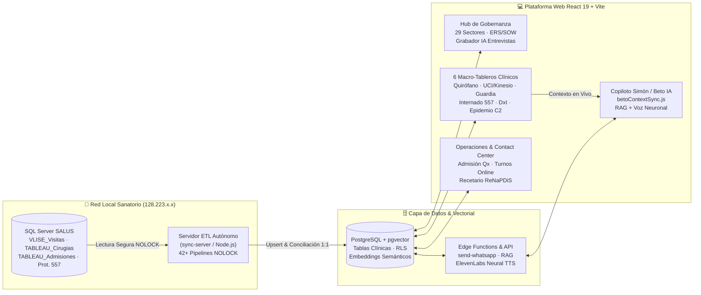

### Reglas de Ingeniería y Calidad de Datos Implementadas
- **Aislamiento Transaccional `WITH (NOLOCK)`**: Todas las consultas sobre `dbo.VLISE_Visitas`, `dbo.TABLEAU_Cirugias`, `dbo.TABLEAU_Admisiones`, `dbo.VLISE_PeticionesPruebas` y `[PR InstRespVisitaPaciente]` se ejecutan sin bloquear tablas del HIS en horario quirúrgico ni de guardia.
- **Conciliación Matemática 1:1 en Quirófano ([`reconcile_surgeries_salus.mjs`](./sync-server/reconcile_surgeries_salus.mjs))**:
  - Elimina automáticamente duplicados generados cuando admisión edita o amplía el segundo nombre/apellido del paciente en SALUS entre el agendamiento y la cirugía, preservando todo el historial de seguimiento de Contact Center.
  - Concilia al 100 % las **Visitas recepcionadas** (`VLISE_Visitas`: ej. **746** en Octubre 2026) con las **Fojas Quirúrgicas** (`TABLEAU_Cirugias`: ej. **747** en Octubre 2026 = **532** en Quirófano Central + **215** en Hospital de Día).
  - Separa **Hemodinamia** del total quirúrgico general y filtra en su pestaña específica únicamente los procedimientos que contaron con participación real de **Anestesiólogo en Foja Quirúrgica** (ej. **3** casos con anestesia sobre 20 totales en Octubre 2026).
- **Depuración Forense del Protocolo 557 en Internado ([`sync_guardia_internado.mjs`](./sync-server/sync_guardia_internado.mjs))**:
  - Audita los campos clínicos reales del Protocolo 557 de SALUS, descartando formularios abiertos en blanco (438 fichas vacías depuradas) y reclasificando automáticamente las evaluaciones clínicas en pisos de otras especialidades como **Interconsultas / Cogestión en Piso** (extrayendo además la evolución clínica desde `idPreguntaPr = 6548`).
- **Ciberseguridad y Cumplimiento de Ley 26.529 (Derechos del Paciente)**:
  - Matriz de Control de Accesos Basada en Roles (**RBAC**), políticas **Row Level Security (RLS)** en PostgreSQL, autenticación multifactor (**2FA por WhatsApp y TOTP RFC 6238 Google/Microsoft Authenticator**), control de sesión única por dispositivo y protección de API interna mediante header `x-admqui-client` y validación de subred institucional.

---

## 🖥️ 3. Recorrido Visual por los Módulos del Sistema (Capturas en Producción)

### 3.1. Hub Central de Gobernanza de Datos (29 Sectores, ERS/SOW y Grabador IA)

El módulo de **Proyectos de Datos** ([`src/components/GobernanzaPanel.jsx`](./src/components/GobernanzaPanel.jsx)) centraliza el relevamiento, la planificación temporal, la documentación técnica SQL y las entrevistas semánticas de los servicios del Sanatorio.

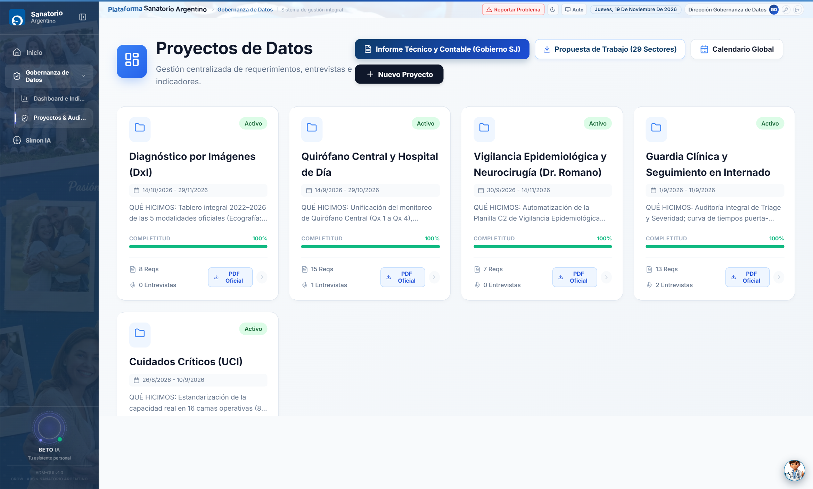

- **Tarjetas de Proyecto con Completitud en Tiempo Real**: Cada servicio muestra su avance porcentual de requerimientos finalizados, cantidad de entrevistas grabadas y acceso en 1 clic a su **Dossier Técnico Oficial en PDF** ([`gobernanzaServiceProjectPdf.js`](./src/utils/gobernanzaServiceProjectPdf.js)).
- **Calendario Global Gantt Interactivo ([`GobernanzaGantt.jsx`](./src/components/GobernanzaGantt.jsx))**: Permite a la Dirección Médica y Gerencia Administrativa auditar la línea de tiempo y cumplimiento de cada proyecto sectorial.

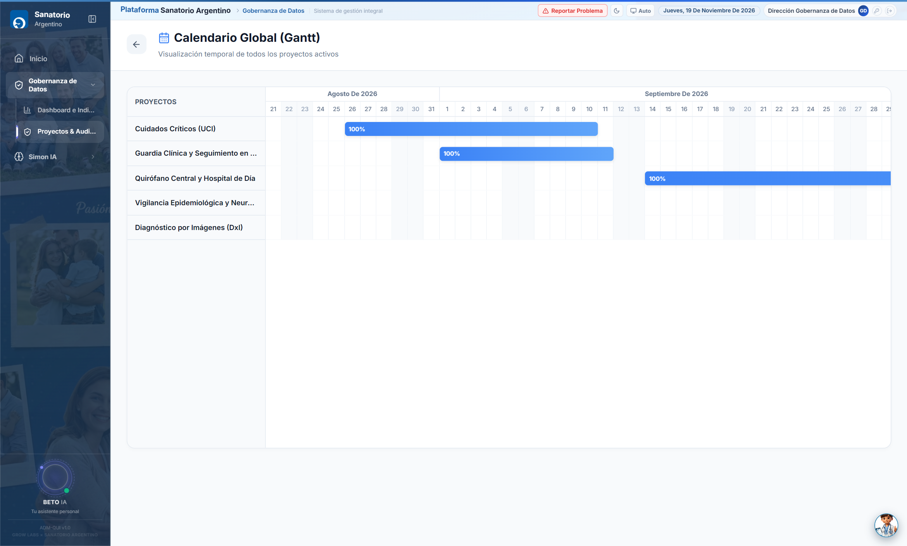

- **Expediente Digital por Servicio (Memoria Técnica, Especificaciones SQL ERS y Grabador IA)**:
  - Documenta qué se implementó en cada servicio, cómo se conectaron las tablas de SALUS y el diccionario de los indicadores SQL auditados.
  - Incluye el **Grabador IA de Entrevistas Semánticas** ([`GobernanzaEntrevistaGrabador.jsx`](./src/components/GobernanzaEntrevistaGrabador.jsx)) con cuestionarios guiados por servicio y transcripción automática.

| Memoria Técnica & Dossier del Servicio | Matriz de Indicadores y Especificaciones SQL (ERS) |
| :---: | :---: |
| 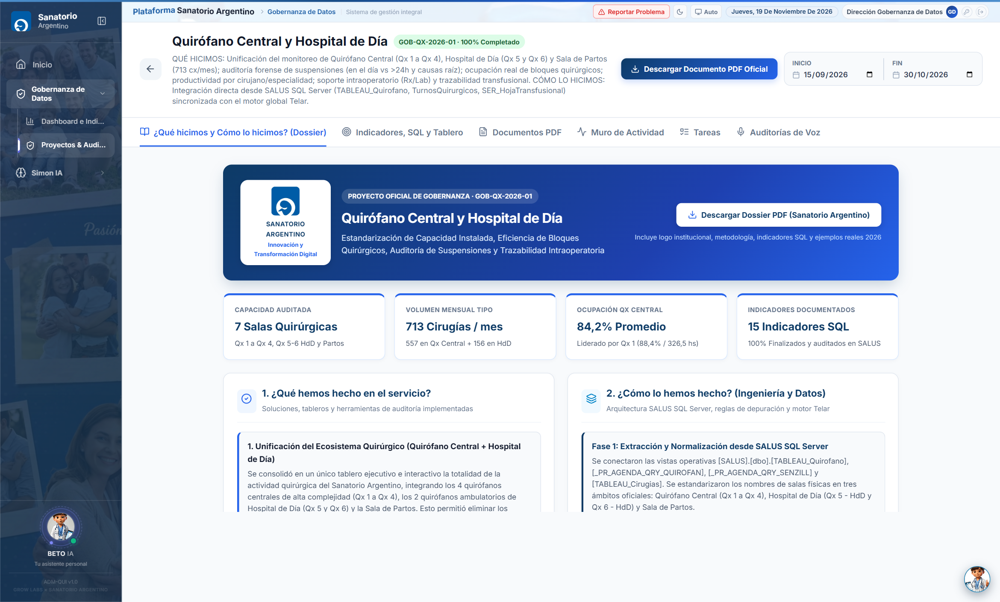 | 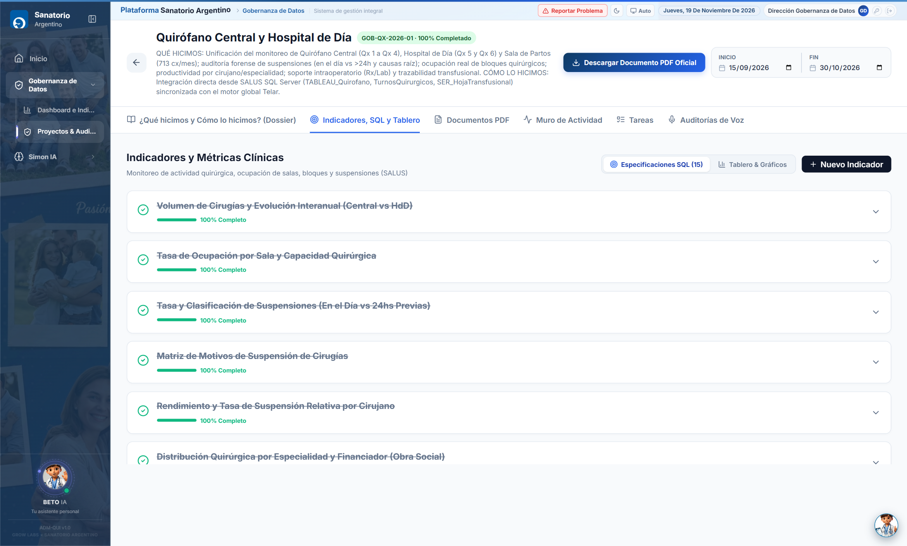 |

---

### 3.2. Quirófano Central, Hospital de Día (HdD) y Bloques Quirúrgicos

El tablero de **Quirófano** ([`src/components/Gobernanza/QuirofanoDashboard.jsx`](./src/components/Gobernanza/QuirofanoDashboard.jsx)) ofrece una auditoría integral de las 7 salas quirúrgicas (`Qx 1` a `Qx 4`, `Sala de Partos` integrada en Quirófano Central, y `Qx 5` / `Qx 6` en Hospital de Día), excluyendo pasajes de hierro/hemoterapia y separando Hemodinamia con anestesia.

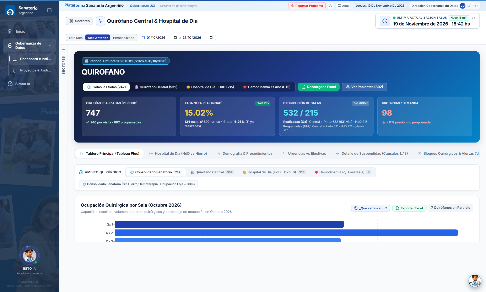

#### ¿Qué hace y cómo lo calcula?
- **Conciliación Dual Foja / Visita**: Muestra el volumen exacto de cirugías realizadas por Foja Quirúrgica (**747** en Octubre 2026: **532** en Quirófano Central + **215** en Hospital de Día) y por Visita recepcionada (**746**), más los procedimientos de **Hemodinamia con Anestesia (3)** en su pestaña dedicada.
- **Tasa Neta Real de Suspensión (Estándar QOAG)**: Descuenta automáticamente del porcentaje bruto de suspensión aquellas cirugías que ya habían sido realizadas o cesáreas que se adelantaron por guardia (**Causal #3**), mostrando el impacto real en puntos porcentuales (`-1.24 p.p.`).
- **Ocupación Real por Sala (`Duración Foja + 30 min`)**: Calcula la saturación física de cada quirófano sumando a los minutos de foja quirúrgica los **30 minutos operativos** de recambio (15 min de pre-ingreso/anestesia + 15 min de higiene/egreso) sobre la ventana estándar de 364 hs/mes.
- **Bloqueo Interactivo (Cross-Filtering) y Exportación Excel de 6 Hojas**: Al hacer clic en cualquier Cirujano, Especialidad u Obra Social, todo el tablero se recalcula para ese filtro y permite descargar el libro Excel institucional estilizado ([`quirofanoExcelExporter.js`](./src/utils/quirofanoExcelExporter.js)).

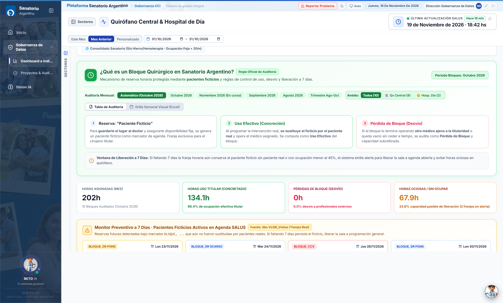

- **Auditoría de Bloques Quirúrgicos y Regla de Liberación a 7 Días**:
  - Audita los 10 bloques quirúrgicos institucionales midiendo exclusivamente las cirugías realizadas **en el día de bloque asignado** (por ejemplo, si el bloque de Cirugía Cardiovascular CCV es los jueves y las cirugías se realizaron miércoles o viernes fuera de bloque, la ocupación del bloque jueves se certifica en **0 %** con alerta `LIBERAR`; y en el bloque de los lunes del Dr. Rodrigo Pons se certifica el **50 %** correspondiente a los 2 lunes utilizados con trazabilidad nominal 1x1 de sus pacientes en SALUS).
  - Monitorea en tiempo real en `dbo.VLISE_Visitas` los marcadores ficticios (`BLOQUE, DR PONS`, `BLOQUE, DR SCARSO`, `BLOQUE, CCV`) para liberar la sala si a 7 días de la fecha la ocupación es menor al 45 %.

---

### 3.3. Cuidados Críticos (UCI), Kinesiología Intensiva y Auditoría de Mortalidad

El tablero de **Cuidados Críticos (UCI)** ([`src/components/Gobernanza/DiasOcupacionDashboard.jsx`](./src/components/Gobernanza/DiasOcupacionDashboard.jsx) y [`UciKinesiologiaPanel.jsx`](./src/components/Gobernanza/UciKinesiologiaPanel.jsx)) monitorea las **16 camas críticas** del Sanatorio (8 de Terapia Intensiva + 8 de Terapia Intermedia).

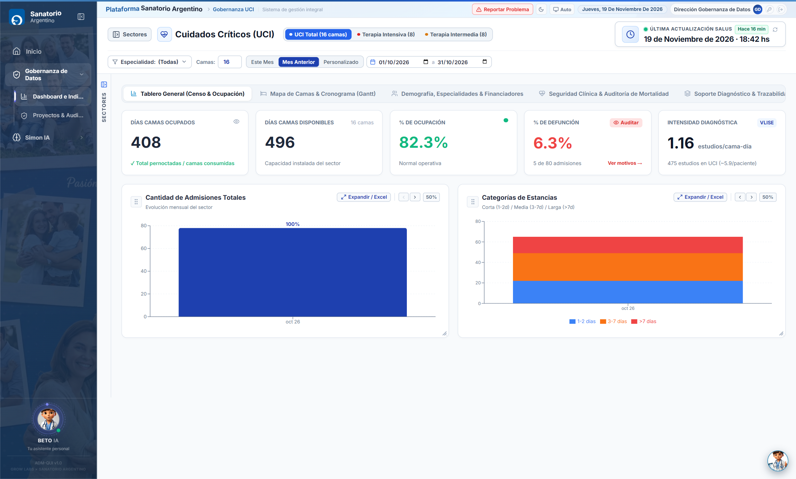

#### ¿Qué hace y cómo lo calcula?
- **Regla Censal Oficial de Días Cama**: Calcula los días camas ocupados (`408`), días disponibles (`496`), porcentaje de ocupación (`82.3 %`) y estadía media (**ALOS**) aplicando la regla hospitalaria donde el día de alta en estancias multi-día no se duplica como día cama ocupado.
- **Auditoría Forense de Mortalidad (`UciMortalidadAuditModal.jsx`)**: Evalúa las defunciones ocurridas estrictamente dentro del período según su fecha de egreso, cruzando scores de severidad, diagnósticos de ingreso y evolución clínica.
- **Mapa Temporal Gantt de Camas UCI y Kinesiología Intensiva**: Visualiza habitación por habitación (`Box 1` a `Box 8` e Intermedia `222` a `229`) la rotación longitudinal de cada paciente y audita las prestaciones kinésicas respiratorias y motoras en pacientes críticos.

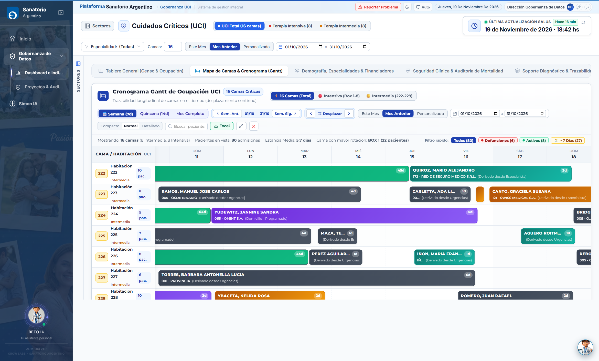

---

### 3.4. Guardia Clínica, Triage Manchester e Internado & Piso (Protocolo 557)

El ecosistema de **Guardia y Urgencias Médicas** ([`GuardiaClinicaDashboard.jsx`](./src/components/Gobernanza/GuardiaClinicaDashboard.jsx) y [`GuardiaInternadoPanel.jsx`](./src/components/Gobernanza/GuardiaInternadoPanel.jsx)) cubre desde que el paciente ingresa por ventanilla de urgencias hasta su resolución ambulatoria, pase a quirófano o seguimiento clínico en piso de internación.

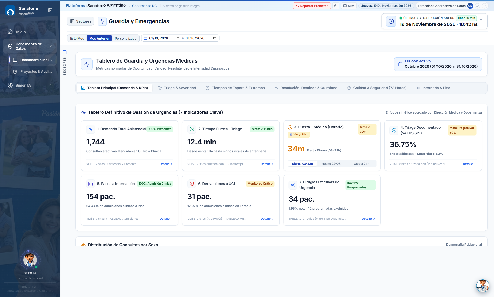

#### ¿Qué hace y cómo lo calcula?
- **7 Indicadores Clave de Urgencias**: Demanda Total Asistencial (`1.744` consultas efectivas), Tiempo Puerta – Triage (`12.4 min`, meta `< 15 min`), Tiempo Puerta – Médico desglosado en franja diurna y nocturna, cobertura de Triage Documentado (Protocolo SALUS 621), Pases a Internación (`154 pac.`), Derivaciones a UCI (`31 pac.`) y Cirugías Efectivas de Urgencia (`34 pac.`).
- **Detección de "Horas Ciegas" en Triage y Curva Interactiva sin Outliers**: Mapea hora por hora (`00:00` a `23:00`) los triages realizados para detectar caídas en cambios de turno y permite activar/desactivar líneas en la curva de tiempos de espera (ocultando outliers extremos por defecto para no comprimir la escala visual).
- **Guardia en Internado & Piso (Auditoría Protocolo 557 + Guía Interactiva `?`)**:
  - Desglosa en 4 sub-pestañas (**Admisiones**, **Seguimiento Clínico en Piso**, **Traumatología en Internado** e **Interconsultas Piso & UCI**) toda la actividad de los médicos clínicos en internación.
  - Certifica el **100 % de admisiones clínicas reales con ficha de admisión completa (Protocolo 557)** (`163 / 163` en Octubre 2026) tras descartar fichas abiertas vacías, e incorpora un botón circular **`(?)`** con la guía metodológica completa del tablero.

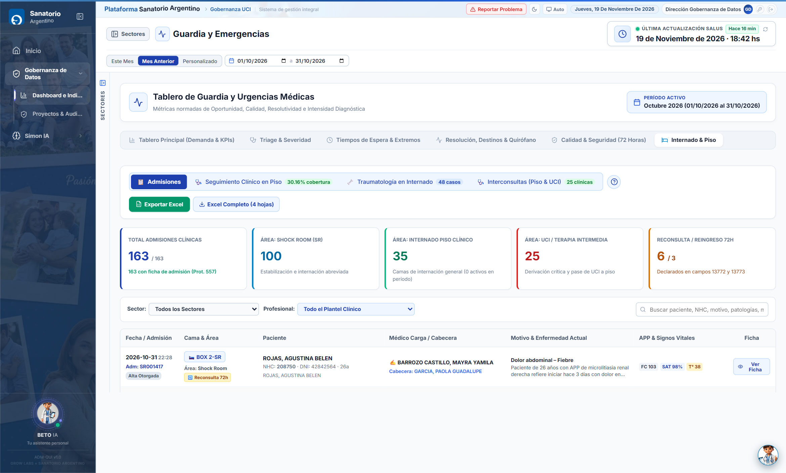

---

### 3.5. Diagnóstico por Imágenes (DxI Reclasificado) y Vigilancia Epidemiológica (SNVS/C2)

El tablero de **Diagnóstico por Imágenes (DxI)** ([`DiagnosticoImagenesDashboard.jsx`](./src/components/Gobernanza/DiagnosticoImagenesDashboard.jsx)) y el de **Vigilancia Epidemiológica** ([`EpidemiologiaDashboard.jsx`](./src/components/Gobernanza/EpidemiologiaDashboard.jsx)) resuelven dos desafíos históricos de codificación en SALUS:

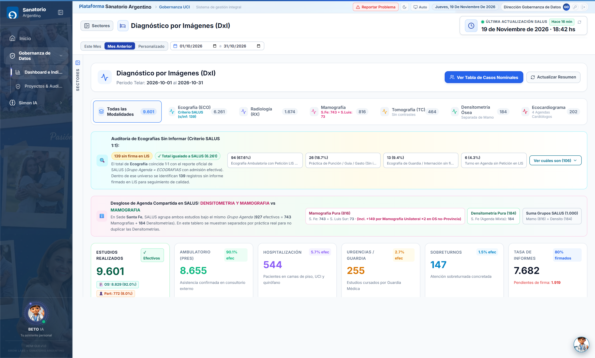

- **Reclasificación Inteligente de Gobernanza en Imágenes (`9.601` estudios/mes)**:
  - En SALUS, numerosos estudios de pacientes internados o de guardia se cargan operativamente bajo origen "Ambulatorio". El motor ETL ([`sync_dxi.mjs`](./sync-server/sync_dxi.mjs)) cruza el estado de asistencia (`INTERNADO`, `URGENCIA`) y el tipo de petición para revelar la verdadera demanda por ámbito (**Ambulatorio Efectivo vs. Hospitalización vs. Guardia**).
  - **Desglose de Agenda Compartida (Mamografía vs. Densitometría Ósea)**: Separa automáticamente por práctica médica real las **Mamografías Puras (`816`)** de las **Densitometrías Óseas (`184`)** que en Sede Santa Fe comparten el mismo grupo de agenda en SALUS.
  - **Auditoría 1:1 de Ecografías sin Informar**: Cruza `VLISE_Visitas` contra peticiones LIS para identificar exactamente qué estudios realizados tienen informe pendiente de firma.
- **Automatización de la Planilla C2 de Vigilancia Epidemiológica Nacional (SNVS 2.0)**: Clasifica automáticamente diagnósticos CIE-10 y motivos de consulta en eventos de notificación obligatoria (ETI, Bronquiolitis, Neumonía, Diarreas Agudas, Varicela, ETS) con distribución por grupo etario y semana epidemiológica.

---

### 3.6. Copiloto Multi-Sectorial «Simón / Beto IA» con RAG y Voz Neuronal

Integrado de forma transversal en toda la plataforma ([`src/components/BetoWidget.jsx`](./src/components/BetoWidget.jsx) y [`src/utils/betoContextSync.js`](./src/utils/betoContextSync.js)), el asistente virtual hospitalario combina **Recuperación Aumentada por Generación (RAG)** con **conciencia en vivo de la pantalla activa**.

- **Sincronización de Contexto en Tiempo Real (`window.__indicadores_active_context`)**: Cuando un jefe de servicio o directivo navega por Quirófano, UCI, Guardia o Imágenes y cambia un filtro de fecha o sala, el copiloto recibe instantáneamente los KPIs, causales de suspensión, obras sociales y pacientes nominales visibles en pantalla, respondiendo con **fidelidad > 95 % y sin alucinaciones**.
- **Síntesis de Voz Neuronal (ElevenLabs TTS)**: Permite escuchar los resúmenes ejecutivos y análisis clínicos con voz natural en español rioplatense ([`sync-server/elevenlabsTts.mjs`](./sync-server/elevenlabsTts.mjs)).
- **Panel de Telemetría y Costos de IA ([`BetoAnalyticsPanel.jsx`](./src/components/BetoAnalyticsPanel.jsx))**: Audita cada interacción, consumo de tokens, tiempos de respuesta y feedback de los profesionales.

---

### 3.7. Operaciones Clínicas y Administrativas Integrales

Además del ecosistema de Gobernanza de Datos, la plataforma centraliza la operación diaria del Sanatorio:

- **Contact Center Omnicanal & Métricas Ejecutivas ([`src/components/ContactCenter/`](./src/components/ContactCenter/ContactCenterMetricsTab.jsx))**:
  - Gestión de conversaciones WhatsApp con pacientes, cálculo de sesiones reales con ventana de inactividad de 1 hora (`get_contact_center_session_counts`: >18.000 sesiones mensuales auditadas), tiempos de primera respuesta, autogestión por Bot vs. derivación a asesoras e incentivos de productividad.
- **Automatización de Cita Online + Confirmación WhatsApp Meta ([`cita-online/`](./cita-online/cita-online) & [`send-whatsapp`](./supabase/functions/send-whatsapp/index.ts))**:
  - Portal de reserva de turnos médicos conectado con SALUS que dispara automáticamente al instante de la reserva la plantilla oficial de Meta WhatsApp Cloud API (`confirmacion_turno_online_automatizacion`) con los datos del paciente, fecha, hora, profesional y sede.
- **Admisión Quirúrgica Pre-Operatoria ([`SurgeryTable.jsx`](./src/components/SurgeryTable.jsx))**:
  - Seguimiento de pacientes programados para cirugía, envío de instrucciones de ayuno/prequirúrgicos por WhatsApp, recepción de documentación y control de autorización por obra social.
- **Nomenclador, Presupuestos, Gestión de Deudas y Recetario Electrónico ReNaPDiS ([`NomencladorView.jsx`](./src/components/NomencladorView.jsx), [`RecetarioView.jsx`](./src/components/RecetarioView.jsx))**:
  - Emisión de pedidos médicos, presupuestos quirúrgicos, seguimiento de cobros y prescripción electrónica validada por token QR.
- **Módulo de Certificación Técnica y Contable Oficial ([`gobernanzaRendicionGobiernoPdf.js`](./src/utils/gobernanzaRendicionGobiernoPdf.js))**:
  - Generador integrado de reportes de avance técnico, físico y financiero para organismos de contralor.

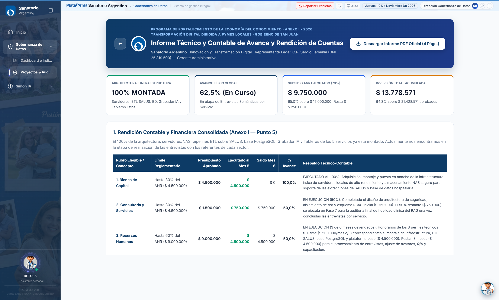

---

## 🚀 4. Ventajas Estratégicas, Clínicas y Operativas

| Dimensión | Situación Previa (AS-IS) | Ventaja con la Plataforma (TO-BE) | Impacto Medible |
| :--- | :--- | :--- | :--- |
| **Integridad y Gobernanza del Dato** | Planillas Excel paralelas y discrepancias entre reportes de Visitas y Fojas en SALUS. | **Fuente única de verdad** conciliada 1:1 con SQL Server SALUS (`747` fojas / `746` visitas) y depuración automática de fichas vacías (Prot. 557). | **100 % de exactitud** entre SALUS y los tableros directivos. |
| **Eficiencia de Planta Quirúrgica** | Bloques quirúrgicos fijos sin auditoría automatizada de uso real en su día asignado. | Matriz de **Bloques Quirúrgicos (Foja + 30m)** con detección de bloques ociosos (`0 %`) y **Alerta de Liberación a 7 Días** sobre pacientes ficticios. | Recuperación de **> 65 horas/mes** de quirófano ocioso. |
| **Oportunidad en Guardia y Triage** | Imposibilidad de visualizar caídas de cobertura de Triage por hora o picos de espera sin distorsión por outliers. | Monitoreo horario de **"Horas Ciegas"**, curva interactiva con filtro de outliers y trazabilidad de conversión a cirugía y retornos a 72 hs. |Tiempo Puerta-Triage controlado en **12,4 min** (meta `< 15 min`). |
| **Auditoría de Historias Clínicas (Prot. 557)** | Revisión manual de fichas de admisión en internado sin distinción entre admisiones clínicas e interconsultas. | Clasificación automática en **Admisiones Clínicas (`163/163`)**, **Seguimiento en Piso**, **Traumatología** e **Interconsultas (`Prot. 6548`)**. | Reducción **> 80 %** en tiempos de auditoría médica de historias clínicas. |
| **Adopción de Inteligencia Artificial** | Uso puntual o aislado ("IA como Alivio"). | **Arquitectura RAG Multi-Sectorial** con Grabador IA de Entrevistas y Copiloto «Simón / Beto IA» conectado en vivo a los datos validados. | **> 95 % de fidelidad** contextual sin alucinaciones clínicas. |
| **Seguridad y Secreto Médico** | Compartición de archivos locales sin trazabilidad de acceso. | **RBAC + RLS + 2FA/TOTP + Control de Sesión Única** y operación sobre red interna del Sanatorio bajo Ley 26.529. | Trazabilidad forense del **100 % de accesos** y exportaciones. |

---

## 📂 5. Estructura del Repositorio

```text
Sistema ADM-QUI/
├── public/                                 # Logos institucionales (logosanatorio.png) y activos estáticos
├── docs/
│   └── screenshots/                        # Capturas reales en alta resolución del sistema en producción
├── src/
│   ├── components/
│   │   ├── Gobernanza/                     # 6 Macro-Tableros Clínicos (Estándar Calidad-QOAG)
│   │   │   ├── QuirofanoDashboard.jsx      # Quirófano Central, HdD, Hemodinamia c/Anest., Bloques y Causales 1..13
│   │   │   ├── DiasOcupacionDashboard.jsx  # Cuidados Críticos (UCI), Censo Diario, ALOS y Soporte VLISE
│   │   │   ├── UciKinesiologiaPanel.jsx    # Kinesiología Intensiva y Prestaciones en UCI
│   │   │   ├── UciMortalidadAuditModal.jsx # Auditoría Forense de Mortalidad en UCI
│   │   │   ├── GuardiaClinicaDashboard.jsx # Guardia: Demanda, Triage, Horas Ciegas, Curva Espera y Paso a Qx
│   │   │   ├── GuardiaInternadoPanel.jsx   # Internado & Piso: Protocolo 557, Seguimiento, Trauma e Interconsultas
│   │   │   ├── DiagnosticoImagenesDashboard.jsx # Imágenes (DxI): 5 Modalidades, Reclasificación y Eco sin informar
│   │   │   └── EpidemiologiaDashboard.jsx  # Vigilancia Epidemiológica Nacional (Planilla C2 / SNVS 2.0)
│   │   ├── ContactCenter/                  # Tableros y Bandeja Omnicanal de Contact Center WhatsApp
│   │   ├── GobernanzaPanel.jsx             # Hub Central de Proyectos de Datos (29 Sectores, Gantt y Dossiers)
│   │   ├── GobernanzaEntrevistaGrabador.jsx# Grabador IA de Entrevistas Semánticas con Cuestionarios por Sector
│   │   ├── GobernanzaIndicadores.jsx       # Matriz de Especificación de Requerimientos (ERS) y Orígenes SQL
│   │   └── BetoWidget.jsx                  # Copiloto Conversacional Multi-Sectorial «Simón / Beto IA»
│   ├── services/                           # Servicios de Autenticación RBAC/2FA, Cirugías, Turnos y Pacientes
│   └── utils/                              # Exportadores Excel 6 hojas, Dossiers PDF y Sincronizador de Contexto IA
├── sync-server/                            # Servidor ETL Autónomo Node.js ↔ SQL Server SALUS (NOLOCK)
│   ├── index.js                            # API Express interna + Pipelines de sincronización SALUS → Supabase
│   ├── daily_sync_job.mjs                  # Orquestador diario de Censo, VLISE, Quirófano, Guardia y Diagnósticos
│   ├── reconcile_surgeries_salus.mjs       # Conciliador exacto 1:1 de Cirugías (Visitas/Fojas y Hemodinamia c/Anest.)
│   ├── sync_guardia_internado.mjs          # Extractor y depurador forense de Protocolo 557 e Interconsultas (6548)
│   ├── sync_kinesiologia_uci.mjs           # Pipeline ETL de Kinesiología Intensiva en UCI
│   └── sync_dxi.mjs                        # Motor analítico de Diagnóstico por Imágenes (2022–2026)
├── supabase/
│   └── functions/                          # Edge Functions Serverless (send-whatsapp Meta Cloud API, IA, etc.)
└── cita-online/                            # Paquete de Producción Angular + Hook WhatsApp para Turnos Online
```

---

## 🛠️ 6. Instalación, Configuración y Despliegue

### Requisitos Previos
- **Node.js** `>= 20.x`
- Acceso en red local o VPN al servidor **SQL Server SALUS** (para el motor `sync-server`)
- Instancia **Supabase / PostgreSQL** con extensión `pgvector`

### 1. Clonar el repositorio e instalar dependencias
```bash
git clone https://github.com/lucasmmg12/quirofano.git
cd quirofano
npm install
cd sync-server && npm install && cd ..
```

### 2. Configurar Variables de Entorno
Crear un archivo `.env` en la raíz para el frontend y `sync-server/.env` para el servidor ETL:

```env
# Frontend (.env)
VITE_SUPABASE_URL=https://<tu-proyecto>.supabase.co
VITE_SUPABASE_ANON_KEY=<tu-anon-key>
VITE_SALUS_SYNC_URL=http://localhost:3456

# Servidor ETL SALUS (sync-server/.env)
PORT=3456
VITE_SUPABASE_URL=https://<tu-proyecto>.supabase.co
SUPABASE_SERVICE_ROLE_KEY=<tu-service-role-key>
SALUS_DB_SERVER=<ip-sql-server-salus>
SALUS_DB_PORT=2450
SALUS_DB_USER=<usuario-lectura-salus>
SALUS_DB_PASSWORD=<password-salus>
SALUS_DB_NAME=SALUS
ELEVENLABS_API_KEY=<opcional-para-voz-neuronal-simon-ia>
```

### 3. Iniciar el Servidor ETL (`sync-server`) y el Frontend (`Vite`)
```bash
# Terminal 1: Iniciar el servidor ETL conectado a SALUS SQL Server
cd sync-server
npm start

# Terminal 2: Iniciar la aplicación web en modo desarrollo o compilar para producción
npm run dev
# Para compilar el bundle optimizado de producción:
npm run build
```

---

<div align="center">

**Desarrollado por el Área de Innovación y Transformación Digital de Sanatorio Argentino S.A. / S.R.L. junto a Grow Labs**  
*San Juan, República Argentina · 2026*

</div>
