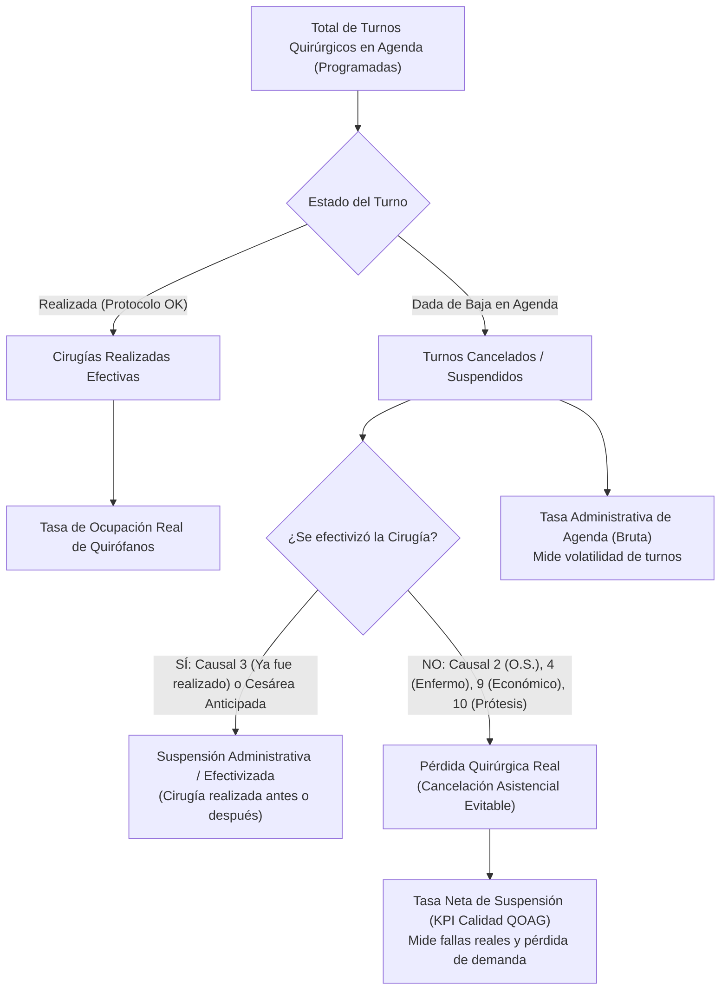

# Modelo de Gobernanza Quirúrgica: Tratamiento del Motivo 3 ("Ya fue realizado") y Anticipaciones Obstétricas
**Sanatorio Argentino — Dirección Médica & Comité de Calidad (QOAG)**  
*Módulo de Gestión de Quirófano, Auditoría de Partes y Tablero Tableau Plus*

---

## 1. Resumen Ejecutivo y Declaración de la Paradoja

En el análisis de rendimiento de quirófanos de Sanatorio Argentino se presenta una anomalía estadística sistemática: **el motivo "3. Ya fue realizado" representa entre el 15% y el 18% del total de suspensiones quirúrgicas registradas** (siendo el segundo motivo de suspensión más frecuente del sanatorio).

### La Paradoja Clínica:
> **Una cirugía registrada bajo el motivo "3. Ya fue realizado" NO es una pérdida de demanda ni un fallo operativo: es una cirugía que efectivamente se llevó a cabo dentro de la institución.**

Sin embargo, en los sistemas tradicionales y tableros no parametrizados, esta cancelación de agenda se suma al numerador de suspensiones, **inflando artificialmente la Tasa de Suspensión Institucional** y distorsionando la evaluación de calidad de cirujanos y obstetras.

---

## 2. Anatomía de los Dos Casos Clínicos Canónicos

### Caso A: Anticipación Obstétrica (Cesárea Programada que Nace por Urgencia)
* **Perfil:** Sanatorio Argentino es el principal centro gineco-obstétrico y materno-infantil de la provincia de San Juan. Las cesáreas electivas se agendan con semanas de antelación (típicamente para la semana 39 de gestación).
* **Fenómeno:** La paciente rompe bolsa, presenta dinámica de parto o una complicación médica en la semana 38 (ej. 14 de octubre).
* **Acto Quirúrgico:** Ingresa por Guardia o Internación de urgencia y la cesárea se realiza ese mismo día (`14/10`) en Sala de Partos o Quirófano Central.
* **Impacto en Agenda:** El turno original que estaba reservado para el `20/10` queda vacante. Por normativa de auditoría médico-legal y trazabilidad contable de SALUS, **este turno nunca puede borrarse de la base de datos**.
* **Cierre en SALUS:** El administrativo de quirófano debe cerrar el turno futuro con estado `Suspendido/Cancelado` bajo la causa **"3. Ya fue realizado"**.
* **Diagnóstico:** Si el tablero computa este registro como una falla de quirófano, penaliza al obstetra y al sanatorio por haber resuelto exitosamente un parto antes de tiempo.

### Caso B: Reprogramación Postergada Efectivizada
* **Perfil:** Cirugías electivas de Cirugía General, Traumatología, Endoscopía, etc.
* **Fenómeno:** Una cirugía programada para el `05/10` debe posponerse por requerimiento clínico menor (ej. ajuste de medicación anticoagulante), optimización de bloque o pedido del paciente.
* **Acto Quirúrgico:** Se reasigna el turno y la intervención se realiza efectivamente el `10/10`.
* **Impacto en Agenda:** El turno original del `05/10` no puede eliminarse de la historia de agenda. Permanece en `dbo.TurnosQuirurgicos` como cancelado.
* **Cierre en SALUS:** Se registra como **"1. Cx Reprogramada"** o **"3. Ya fue realizado"** (cuando se audita retrospectivamente comprobando que el paciente ya fue operado).
* **Diagnóstico:** El procedimiento ingresó al sanatorio, se facturó y consumió horas quirúrgicas; computarlo como cancelación neta duplica el recuento de pacientes y subestima la efectividad del servicio.

---

## 3. Modelo Matemático y Métrica Dual de Gobernanza

Para resolver esta distorsión sin perder la trazabilidad de agenda, el Sanatorio Argentino adopta el estándar de **Métrica Dual de Suspensión**:



### 3.1. Tasa de Suspensión Administrativa (Bruta)
Mide la **volatilidad operativa de la agenda** y el movimiento de reservas:
$$\text{Tasa Administrativa (\%)} = \left( \frac{\text{Total de Turnos Dados de Baja (Causales 1 al 13)}}{\text{Total de Turnos Programados}} \right) \times 100$$

### 3.2. Tasa Neta de Suspensión Quirúrgica (KPI Oficial de Calidad QOAG)
Mide la **verdadera pérdida de oportunidad quirúrgica** o cancelaciones no resueltas:
$$\text{Tasa Neta Real (\%)} = \left( \frac{\text{Suspensiones Totales} - \text{Causal 3 ('Ya fue realizado')} - \text{Reprogramaciones Efectivizadas}}{\text{Total de Turnos Programados}} \right) \times 100$$

> **Impacto Empírico en Sanatorio Argentino:**
> En un mes estándar con 600 cirugías programadas y 40 cancelaciones de agenda (Tasa Bruta: **6.67%**), aproximadamente 12 casos corresponden a "Ya fue realizado" o reprogramaciones exitosas. La Tasa Neta Real desciende a **4.66%**, cumpliendo el benchmark de calidad (< 5.0%).

---

## 4. Consulta SQL Canónica de Trazabilidad (Motor SALUS T-SQL)

Esta consulta realiza un autocruce (*Self-Outer-Apply*) entre la agenda de turnos y los protocolos reales en una ventana temporal de $\pm 30$ días para catalogar automáticamente cada caso:

```sql
-- =========================================================================================
-- CONSULTA MAESTRA DE AUDITORÍA: TRAZABILIDAD DEL CAUSAL 3 ("YA FUE REALIZADO") Y CESÁREAS
-- Servidor: 128.223.16.29:2450 | Base: SALUS | Motor: T-SQL
-- =========================================================================================
DECLARE @FechaInicio DATE = '2026-10-01';
DECLARE @FechaFin    DATE = '2026-10-31';

SELECT 
    tq.IdTurno,
    tq.IdPaciente,
    pac.NombreCompleto AS Paciente,
    pac.NumeroDocumento AS DNI,
    tq.FechaProgramada AS FechaTurnoCancelado,
    tq.HoraProgramada,
    med.NombreCompleto AS CirujanoTurno,
    esp.Nombre AS Especialidad,
    ms.CodigoMotivo,
    ms.Descripcion AS MotivoRegistrado,
    tq.MotivoSuspension AS ObservacionMotivo,
    
    -- Trazabilidad con la cirugía que efectivamente se realizó
    pq.IdProtocolo AS IdProtocoloRealizado,
    pq.FechaCirugia AS FechaCirugiaRealizada,
    pq.HoraEntradaSala AS HoraEntradaReal,
    sqReal.NombreSala AS SalaEfectiva,
    medReal.NombreCompleto AS CirujanoReal,
    
    -- Tipificación clínica de auditoría
    CASE 
        WHEN pq.IdProtocolo IS NOT NULL AND pq.FechaCirugia < tq.FechaProgramada 
            THEN 'ANTICIPACION_OBSTETRICA_O_URGENCIA'
        WHEN pq.IdProtocolo IS NOT NULL AND pq.FechaCirugia > tq.FechaProgramada 
            THEN 'REPROGRAMACION_DIFERIDA_EFECTIVIZADA'
        WHEN pq.IdProtocolo IS NOT NULL AND pq.FechaCirugia = tq.FechaProgramada 
            THEN 'REASIGNACION_SALA_MISMO_DIA'
        ELSE 'SUSPENSION_SIN_EFECTIVIZACION_DETECTADA'
    END AS TipoTrazabilidadAuditoria,
    
    DATEDIFF(DAY, tq.FechaProgramada, pq.FechaCirugia) AS DiasDiferencia
FROM dbo.TurnosQuirurgicos tq
LEFT JOIN dbo.MotivosSuspension ms ON tq.IdMotivoSuspension = ms.IdMotivo
INNER JOIN dbo.Pacientes pac ON tq.IdPaciente = pac.IdPaciente
LEFT JOIN dbo.Medicos med ON tq.IdMedicoCirujano = med.IdMedico
LEFT JOIN dbo.Especialidades esp ON tq.IdEspecialidad = esp.IdEspecialidad

-- Autocruce con Protocolos Quirúrgicos en ventana de +/- 30 días
OUTER APPLY (
    SELECT TOP 1 
        pqInner.IdProtocolo,
        pqInner.FechaCirugia,
        pqInner.HoraEntradaSala,
        pqInner.IdSala,
        pqInner.IdMedicoCirujano
    FROM dbo.ProtocolosQuirurgicos pqInner
    WHERE pqInner.IdPaciente = tq.IdPaciente
      AND pqInner.EstadoCirugia = 'Realizada'
      AND pqInner.FechaCirugia BETWEEN DATEADD(DAY, -30, tq.FechaProgramada) AND DATEADD(DAY, 30, tq.FechaProgramada)
    ORDER BY ABS(DATEDIFF(MINUTE, CAST(pqInner.FechaCirugia AS DATETIME), CAST(tq.FechaProgramada AS DATETIME))) ASC
) pq
LEFT JOIN dbo.SalasQuirurgicas sqReal ON pq.IdSala = sqReal.IdSala
LEFT JOIN dbo.Medicos medReal ON pq.IdMedicoCirujano = medReal.IdMedico

WHERE tq.Estado IN ('Suspendido', 'Cancelado')
  AND (ms.CodigoMotivo IN (1, 3) OR tq.MotivoSuspension LIKE '%ya fue real%' OR tq.MotivoSuspension LIKE '%reprogram%')
  AND tq.FechaProgramada BETWEEN @FechaInicio AND @FechaFin
ORDER BY tq.FechaProgramada DESC;
```

---

## 5. Implementación en el Tablero de Quirófano (Dashboard React + Vite)

Para hacer operativa esta lógica de cara a la Dirección y Coordinación Quirúrgica:

1. **KPI Cards Reactivas con Doble Vista:**
   * Visualización simultánea de:
     * **Cirugías Realizadas Efectivas**.
     * **Tasa Neta Real (Calidad QOAG)** con desglose interactivo.
     * Indicador del **Impacto Ficticio de Motivo 3**: muestra exactamente cuántos puntos porcentuales se reducen al computar las cirugías efectivizadas.
2. **Módulo de Auditoría en la Pestaña de Suspensiones:**
   * Tarjeta destacada con alerta institucional:
     *"Auditoría Especial: Paradoja del Motivo 3 ('Ya fue realizado') y Anticipaciones Obstétricas"*.
   * Botón directo para filtrar la nómina de pacientes con trazabilidad cruzada.
   * Botón de exportación a Excel con la clasificación `ANTICIPACION_OBSTETRICA` vs `REPROGRAMACION_DIFERIDA`.
3. **Protección del Score de Cirujanos:**
   * En el **Ranking de Cirujanos**, la columna `% Susp.` calcula la tasa neta real descontando las cesáreas anticipadas y reprogramaciones efectivizadas del cirujano, evitando injusticias en las auditorías de desempeño.

---

## 6. Procedimiento Operativo para Secretaría de Quirófano (SOP)

1. **Cuando una cesárea programada se adelanta por urgencia:**
   * La secretaria o instrumentador de guardia confecciona el protocolo quirúrgico de la urgencia con la fecha y hora reales.
   * Al auditar la agenda futura, ubica el turno electivo que había quedado reservado y selecciona:
     * Estado: `Cancelado`.
     * Motivo: `3. Ya fue realizado`.
     * Observación obligatoria: `"Adelantada por urgencia / Protocolo #[NroProtocolo] del [FechaReal]"`.
2. **Cuando una cirugía se reprograma para una nueva fecha:**
   * No eliminar el turno anterior.
   * Marcar como `1. Cx Reprogramada`.
   * En el nuevo turno, referenciar en instrucciones: `"Reprogramación del turno original [FechaOriginal]"`.

---
*Documento aprobado para integración analítica en el Ecosistema Digital Sanatorio Argentino (ADM-QUI / Gobernanza).*
